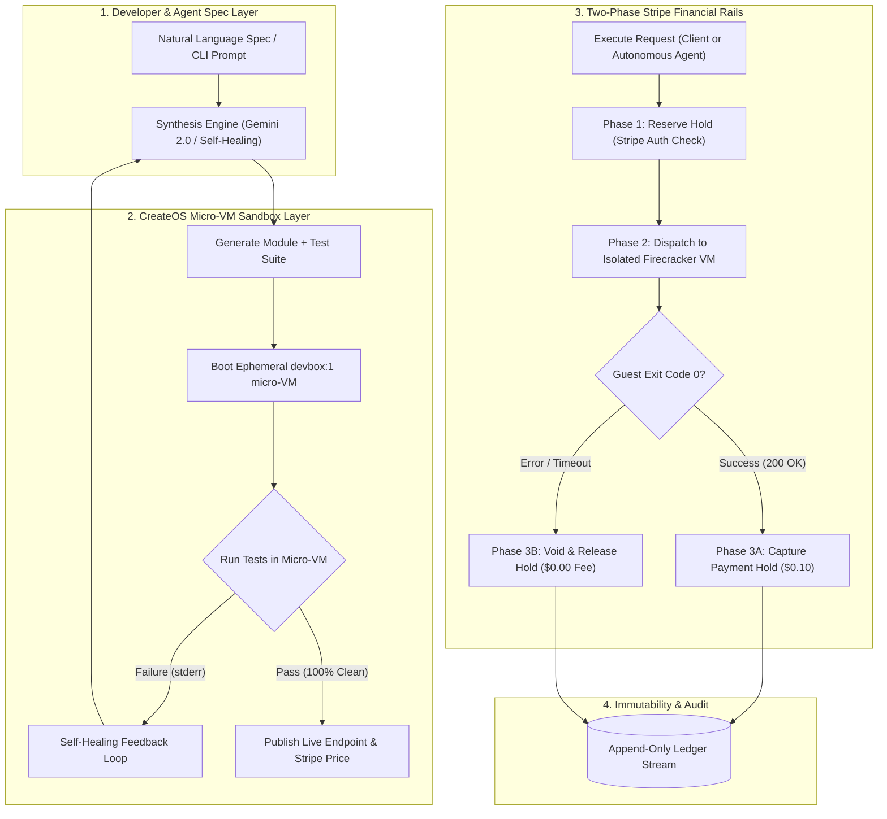

# ⚡ MicroForge
> **Autonomous Developer Agent for Monetized Micro-Tools & Agent APIs**  
> Built by **SouthenEmpire** for the **CreateOS × Stripe Projects Online Hackathon** (October 2026).

[](https://createos.sh)
[](https://stripe.com)
[](https://nextjs.org)
[](https://privy.io)
[](https://www.kaggle.com/whitepaper-vibe-coding-agent-security-and-evaluation)

---

## 🏆 Hackathon Submission Checklist & Verification Links

| Requirement | Status | Links & Details |
| :--- | :---: | :--- |
| **1. Public GitHub Repo** | ✅ Completed | [github.com/southenempire/southen-microforge](https://github.com/southenempire/southen-microforge) |
| **2. Demo Video (2–3 mins, face on cam)** | 🎥 Ready for URL | [YouTube Demo Video Walkthrough](https://youtu.be/YOUR_DEMO_VIDEO) *(Walkthrough with webcam)* |
| **3. Stripe Projects Leaderboard** | 🚀 Ready to Submit | [projects.dev/leaderboard](https://projects.dev/leaderboard) — Entry Code: **`CreateOS-2026`** |
| **4. Social Media Post** | 📣 Drafted | Tag `@createosai` on [X / Twitter](https://x.com/createosai) & `CreateOS` on [LinkedIn](https://linkedin.com) |
| **5. Sponsor Technologies** | ✅ 100% Integrated | **CreateOS** (`@nodeops-createos/sandbox` Firecracker micro-VMs) + **Stripe Projects** (Two-Phase Pre-auth Hold / Capture Rails) + **Privy** Social Auth |
| **6. Agent Standard Compliance** | ✅ Live | Standard OpenAI Function Calling Schema at [`/api/tools?format=agent`](https://southen-microforge.vercel.app/api/tools?format=agent) |

---

## 🎯 Executive Summary & The Problem We Solve

Building and operating single-purpose micro-APIs (JWT inspectors, HMAC signature validators, CSV-to-SQL transformers, sanitizers, or contract analyzers) forces developers and autonomous agent swarms into hours of repetitive plumbing:
- Writing sandboxed runners so user code doesn't compromise the server.
- Writing test suites and fixing edge cases.
- Hooking up payment gateways, pre-authorizations, and credit card holds.
- Providing schemas so AI agents can invoke tools autonomously.

**MicroForge solves this end-to-end in seconds:**
1. **Spec-to-Code Synthesis**: Natural language specifications are translated into production TypeScript/JavaScript modules alongside automated test suites.
2. **CreateOS Firecracker Micro-VM Execution**: Untrusted code runs in hardware-isolated Linux micro-VMs (`s-1vcpu-1gb`, `devbox:1`) via `@nodeops-createos/sandbox`.
3. **Self-Healing Feedback Loop**: If unit tests fail in the sandbox, stderr traces feed back into the synthesis engine to iteratively repair and verify the code until 100% of test assertions pass.
4. **Stripe Projects Two-Phase Rails**: Every execution follows an enterprise-grade financial state machine (`RESERVED_HOLD` → `RUN_VM` → `CAPTURED` / `RELEASED`). **Users are never charged if code errors or times out.**
5. **Privy Embedded Social Auth**: Instant developer sign-in via Google, GitHub, X, Discord, and Email without passwords or Web3 wallet prompts.
6. **Autonomous Agent Tool Discovery**: Autonomous agents can query `/api/tools?format=agent` to dynamically discover schemas and execute isolated tools.

---

## 🏗️ Architecture & State Machine



---

## 🔒 Kaggle Vibe Coding Agent Security Standard

MicroForge strictly aligns with the security principles defined in the [Kaggle Whitepaper – Vibe Coding Agent Security and Evaluation](https://www.kaggle.com/whitepaper-vibe-coding-agent-security-and-evaluation):

1. **Zero Runtime Escape**: No guest code ever runs on the host Next.js server. Every run executes inside isolated CreateOS Firecracker micro-VM containers with hardware boundary limits (5000ms max timeout, 1GB RAM cap).
2. **Deterministic Evaluation**: Modules cannot be deployed to the catalog without passing automated unit tests executed inside the sandbox.
3. **Zero Financial Loss (Hold-and-Capture)**: Pre-authorization holds are only settled *after* execution succeeds. In failure scenarios (e.g., `ERR_TIMEOUT`, `ERR_SANDBOX_EXIT`), holds are atomically cancelled, ensuring buyers are never billed for faulty tools.
4. **Zero Secret Leakage**: Privy secrets, CreateOS keys, and Stripe tokens remain securely in server-side environment variables and are never bundled into the client.

---

## 🤖 Autonomous Agents: Tool Calling & Discovery

Autonomous agent frameworks (LangChain, AutoGen, CrewAI, OpenAI Agents SDK) can dynamically query MicroForge to discover and run monetized tools.

### 1. Discover Available Tools as OpenAI Functions
```bash
curl -s https://southen-microforge.vercel.app/api/tools?format=agent
```

**Response Format:**
```json
{
  "provider": "MicroForge",
  "protocol": "OpenAI Tools Function Calling (2026)",
  "endpoint": "https://southen-microforge.vercel.app/api/execute",
  "billing": "Two-Phase Stripe Rails (Pre-auth Hold -> Isolated Firecracker Micro-VM -> Capture)",
  "tools": [
    {
      "type": "function",
      "function": {
        "name": "markdown_sanitizer",
        "description": "Strips raw script injections and outputs safe clean markdown [MicroForge Isolation: Firecracker micro-VM. Per-run cost: $0.10]",
        "parameters": {
          "type": "object",
          "properties": {
            "text": { "type": "string", "description": "Parameter text for Markdown Sanitizer" }
          },
          "required": ["text"]
        }
      }
    }
  ]
}
```

### 2. Execute a Tool via cURL
```bash
curl -X POST https://southen-microforge.vercel.app/api/execute \
  -H "Content-Type: application/json" \
  -d '{
    "slug": "markdown-sanitizer",
    "payload": {
      "text": "# Hello <script>alert(1)</script> World"
    }
  }'
```

**Response:**
```json
{
  "success": true,
  "state": "captured",
  "executionId": "exec_oj3nf8o",
  "output": {
    "success": true,
    "plainText": "Hello <script>alert(1)</script> World",
    "wordCount": 3,
    "linksExtracted": []
  },
  "durationMs": 10,
  "amountChargedCents": 10
}
```

---

## 💻 Tech Stack & Architecture Matrix

| Layer | Component | Description |
|---|---|---|
| **Frontend & SSR** | Next.js 16.4.2 (Turbopack, React 19) | Dark/Light mode theme system, responsive Linear/Stripe design |
| **Authentication** | Privy (`cmvcwkmep007b0fl4skzwa7j8`) | Embedded social sign-in (Google, GitHub, X, Discord, Email) |
| **Micro-VM Sandboxing** | CreateOS (`@nodeops-createos/sandbox`) | Firecracker ephemeral micro-VMs (`devbox:1`, `s-1vcpu-1gb`) |
| **Financial Rails** | Stripe Projects SDK (`stripe`) | Two-Phase pre-authorization and capture state machine |
| **Agent Intelligence** | `@google/genai` (Gemini 2.0 Flash) | Spec parsing, synthesis, and self-healing error analysis |
| **Audit Ledger** | PostgreSQL Append-Only Ledger | Immutability, audit logs, hold tracking, and revenue telemetry |

---

## 🛠️ Local Development Setup

### 1. Clone & Install
```bash
git clone https://github.com/southenempire/southen-microforge.git
cd southen-microforge
npm install
```

### 2. Configure Environment (`.env.local`)
```env
# CreateOS Sandbox Credentials
CREATEOS_API_KEY=your_createos_api_token
CREATEOS_SANDBOX_BASE_URL=https://api.createos.sh

# Stripe Projects Credentials
STRIPE_ACCOUNT_ID=acct_your_stripe_account
STRIPE_PROJECT_NAME=southen-microforge

# Privy Embedded Auth
NEXT_PUBLIC_PRIVY_APP_ID=cmvcwkmep007b0fl4skzwa7j8
PRIVY_APP_SECRET=your_privy_secret

# Google Gemini Intelligence
GEMINI_API_KEY=your_gemini_api_key
```

### 3. Run Development Server
```bash
npm run dev
```
Open [http://localhost:3000](http://localhost:3000) in your browser.

### 4. Run TypeScript Check
```bash
npx tsc --noEmit
```

---

## 👥 Team & Submission Information
- **Team Name**: SouthenEmpire
- **Lead Builder**: southen03@gmail.com
- **Telegram**: [@southen13](https://t.me/southen13)
- **X / Twitter**: [@southen13](https://x.com/southen13)
- **Hackathon**: CreateOS × Stripe Projects Online Hackathon (October 2026)
- **Projects.dev Leaderboard Entry Code**: `CreateOS-2026`
