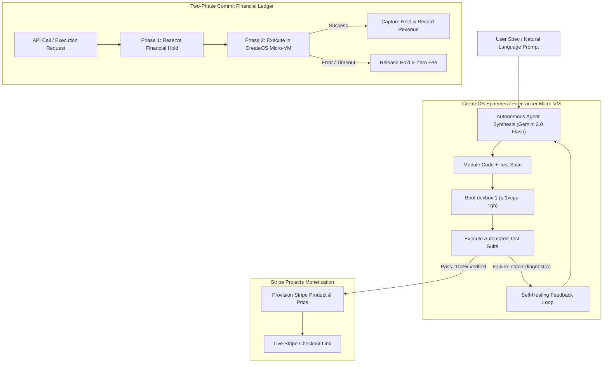

# ⚡ MicroForge
> **Autonomous Developer Agent for Monetized Micro-Tools**  
> Built by **SouthenEmpire** for the **CreateOS × Stripe Projects Hackathon** (October 2026).

[](https://createos.sh)
[](https://stripe.com)
[](https://nextjs.org)
[](https://www.kaggle.com/whitepaper-vibe-coding-agent-security-and-evaluation)

---

## 🎯 Executive Summary

**MicroForge** transforms plain English ideas into live, secure, monetized micro-tools in seconds.

Developers frequently need focused utility tools: Markdown sanitizers, JWT claims decoders, webhook HMAC verifiers, SQL query explainers, or API payload diff engines. Building, testing, securing, and wiring Stripe billing for each one traditionally takes hours of boilerplate.

With MicroForge:
1. **Spec-to-Code Synthesis**: An autonomous agent analyzes requirements and authors both the module code and an automated verification test suite.
2. **CreateOS Firecracker Micro-VM Sandbox**: MicroForge spins up an isolated, ephemeral Linux micro-VM via `@nodeops-createos/sandbox` (`s-1vcpu-1gb`, `devbox:1`) to execute tests in clean isolation.
3. **Self-Healing Feedback Loop**: If verification tests fail in the sandbox, stderr output is passed back to the agent with targeted diagnostics to iteratively patch the code until 100% test coverage is achieved.
4. **Stripe Projects Monetization**: Upon passing verification, the agent automatically registers products and pricing tiers on Stripe, generating one-click payment and subscription links.
5. **Two-Phase Commit Financial Ledger**: Every execution follows an enterprise-grade state machine (`RESERVE_HOLD` → `EXECUTE_SANDBOX` → `CAPTURE` / `RELEASE_ON_FAIL`). **Users are never charged if code fails.**

---

## 🏗️ Architecture & Execution Flow



---

## 🔒 Kaggle Vibe Coding Agent Security & Evaluation Standards

MicroForge adheres strictly to the security, sandboxing, and evaluation principles established in the [Kaggle Whitepaper – Vibe Coding Agent Security and Evaluation](https://www.kaggle.com/whitepaper-vibe-coding-agent-security-and-evaluation):

* **Hermetic Code Isolation**: User-generated code NEVER executes directly in the host application runtime. All untrusted code is dispatched to ephemeral CreateOS Firecracker micro-VMs with CPU and memory caps.
* **Deterministic Verification**: Every generated tool must pass strict automated test assertions before being registered in the storefront.
* **Financial Failsafe (Two-Phase Commit)**: Payment holds are never captured prior to successful micro-VM exit. Network timeouts or runtime crashes trigger atomic hold releases.
* **Zero Credential Leakage**: All keys (`CREATEOS_API_KEY`, `STRIPE_ACCOUNT_ID`, `GEMINI_API_KEY`) remain strictly server-side in `.env.local` and are never exposed to client bundles or git histories.

---

## 🚀 Key Features

* **Clean Developer-First UI**: Dark-mode `#09090b` aesthetic with monospace metrics, live execution telemetry, step indicators, and instant test suite inspection.
* **Interactive Tool Playground**: Test built micro-tools live with custom JSON payloads and observe real-time execution times and outputs.
* **Live Financial Ledger**: Append-only audit stream visualizing holds, captures, releases, and transaction balances.
* **Stripe Integration**: Supports per-call pricing (e.g. \$0.05, \$0.10, \$0.25) and pre-configured test-mode checkout sessions.
* **Pre-Seeded Catalog**: Comes with out-of-the-box verified tools (Markdown Sanitizer, JWT Claims Decoder, Webhook HMAC Verifier).

---

## 💻 Tech Stack

| Layer | Technology |
|---|---|
| **Framework** | Next.js 16.4.2 (App Router, Turbopack, React 19) |
| **Language** | TypeScript 5.0 (Strict mode) |
| **Styling** | Tailwind CSS v4, Lucide Icons, Canvas Confetti |
| **Micro-VM Sandbox** | `@nodeops-createos/sandbox` (Firecracker Micro-VMs) |
| **Monetization** | Stripe Projects SDK (`stripe`) |
| **Agent Intelligence** | `@google/genai` (Gemini 2.0 Flash) with resilient synthesis |
| **Persistence** | In-Memory Atomic Ledger with Supabase schema compatibility |

---

## 🛠️ Local Development Setup

### 1. Clone & Install
```bash
git clone https://github.com/southenempire/southen-microforge.git
cd southen-microforge
npm install
```

### 2. Configure Environment
Create a `.env.local` file in the project root:
```env
# CreateOS Sandbox Credentials
CREATEOS_API_KEY=your_createos_api_token
CREATEOS_SANDBOX_BASE_URL=https://api.createos.sh

# Stripe Projects Credentials
STRIPE_ACCOUNT_ID=acct_your_stripe_account
STRIPE_PROJECT_NAME=southen-microforge

# Google Gemini Credentials (Optional - Falls back to resilient synthesis engine)
GEMINI_API_KEY=your_gemini_api_key
```

### 3. Run Development Server
```bash
npm run dev
```
Open [http://localhost:3000](http://localhost:3000) to access the MicroForge Agent Studio.

### 4. Build for Production
```bash
npm run build
npm run start
```

---

## 👥 Team
- **Team Name**: SouthenEmpire
- **Member**: southen03@gmail.com
- **Hackathon**: CreateOS × Stripe Projects Online Hackathon (Oct 2026)
